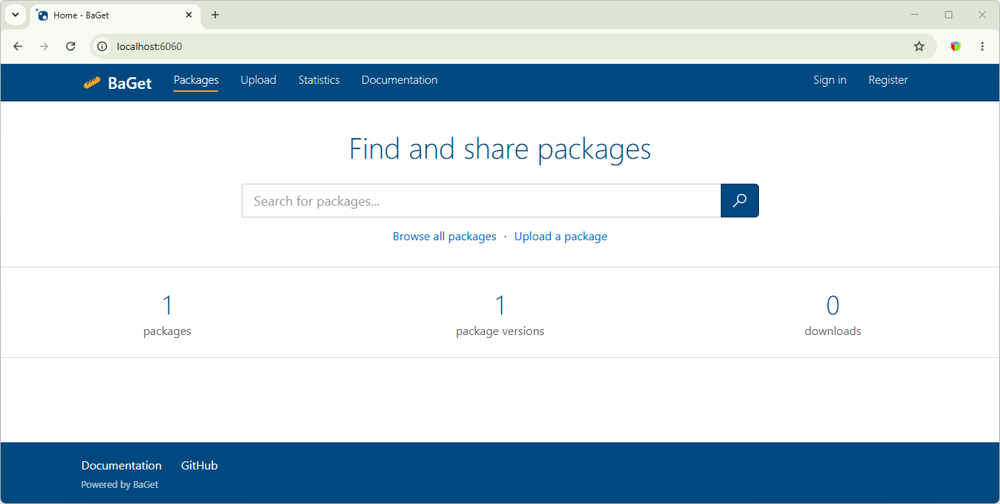

# BaGet Extension :baguette_bread:

![Build status]

A lightweight [NuGet] and [symbol] server.

<p align="center">
  
</p>

## Getting Started

1. Install the [.NET SDK] (BaGet Extension targets .NET 10)
2. Download the `BaGet` artifact of a [Release workflow] run, or build it from source (see [CONTRIBUTING.md](CONTRIBUTING.md))
3. Start the service with `dotnet BaGet.dll`
4. Browse `http://localhost:6060/` in your browser (the port is set by `Kestrel:Endpoints` in `appsettings.json`)

For more information, please refer to the [documentation]. To build and test from source (nuget.config lists the untracked `Packages` folder as a package source, so create it once):

```
mkdir Packages
dotnet build BaGet.sln -p:GeneratePackageOnBuild=false
dotnet test BaGet.sln -p:GeneratePackageOnBuild=false
```

The screenshot above shows the upstream project's UI, not the current one.

## Features

* **Cross-platform**: runs on Windows, macOS, and Linux!
* **Cloud native**: supports [Docker], [Azure], [AWS], [Google Cloud], [Alibaba Cloud]
* **Four databases**: SQLite, SQL Server, PostgreSQL and MySQL, plus Azure Table Storage
* **Offline support**: [mirror a NuGet server] to speed up builds and enable offline downloads
* **NuGet V3 protocol**, including the catalog, vulnerability info, deprecation, report abuse and package details templates
* **NuGet V2 (OData) feed** for `nuget list`, older clients and PowerShellGet (on by default; `Feeds:EnableV2=false` turns it off)
* **Accounts** (on by default; `Accounts:Enabled=false` restores the global `ApiKey` alone; while `ApiKey` is empty, pushes need a user API key): sign-in, OpenID Connect, package owners, organizations and scoped, expiring API keys
* **Validation pipeline** (opt-in): packages are checked before they are served, and can be repository signed
* **Web UI**: package pages, owner management pages, profiles, statistics and abuse reports

[Build status]: https://img.shields.io/github/actions/workflow/status/pieroviano/BaGet/main.yml?branch=main

[NuGet]: https://learn.microsoft.com/nuget/what-is-nuget
[symbol]: https://docs.microsoft.com/en-us/windows/desktop/debug/symbol-servers-and-symbol-stores
[.NET SDK]: https://www.microsoft.com/net/download

[Release workflow]: https://github.com/pieroviano/BaGet/actions/workflows/release.yml

[Documentation]: docs/index.md
[Docker]: docs/installation/docker.md
[Azure]: docs/installation/azure.md
[AWS]: docs/installation/aws.md
[Google Cloud]: docs/installation/gcp.md
[Alibaba Cloud]: docs/installation/aliyun.md

[Mirror a NuGet server]: docs/configuration.md#enable-read-through-caching
